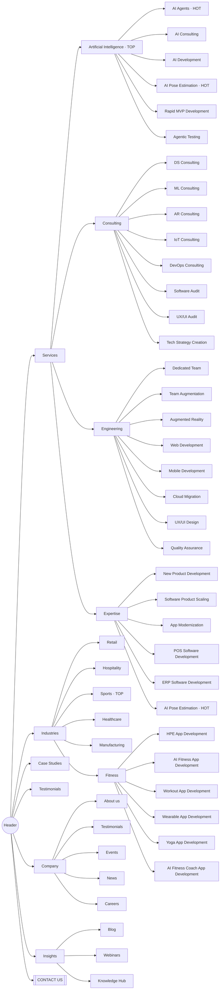

# Карта меню хедера mobidev.biz

Знято з живого сайту https://mobidev.biz/ (розмітка `#menu-header-menu`) 21.10.2026.
Десктопне мега-меню і мобільне меню містять ті самі пункти.

7 пунктів верхнього рівня + кнопка **CONTACT US**, разом 53 посилання (50 унікальних URL).

## Схема

## Повне дерево з URL

Базовий домен `https://mobidev.biz`. «—» означає, що заголовок не є посиланням (`href="#"` або ``).

### 1. Services — мега-меню з вкладками

| Вкладка | Пункт | URL |
|---|---|---|
| **Artificial Intelligence** `TOP` | — | — |
| | AI Agents `HOT` | `/services/ai-agent-development` |
| | AI Consulting | `/services/ai-consulting` |
| | AI Development | `/services/artificial-intelligence` |
| | AI Pose Estimation `HOT` | `/services/human-pose-estimation-app-development` |
| | Rapid MVP Development | `/services/rapid-mvp-development` |
| | Agentic Testing | `/services/ai-agentic-testing` |
| **Consulting** | (заголовок вкладки) | `/services/technology-consulting` |
| | DS Consulting | `/services/data-science` |
| | ML Consulting | `/services/machine-learning-consulting` |
| | AR Consulting | `/services/ar-consulting` |
| | IoT Consulting | `/services/iot-development` |
| | DevOps Consulting | `/services/devops-consulting-and-engineering` |
| | Software Audit | `/services/software-audit` |
| | UX/UI Audit | `/services/ux-ui-design-audit` |
| | Tech Strategy Creation | `/services/tech-strategy-consulting` |
| **Engineering** | (заголовок вкладки) | `/services/software-engineering` |
| | Dedicated Team | `/services/dedicated-development-team` |
| | Team Augmentation | `/services/software-development-team-augmentation` |
| | Augmented Reality | `/services/augmented-reality` |
| | Web Development | `/services/web-application-development` |
| | Mobile Development | `/services/mobile-application-development` |
| | Cloud Migration | `/services/cloud-migration-modernization` |
| | UX/UI Design | `/services/ui-ux-design` |
| | Quality Assurance | `/services/qa-software-testing` |
| **Expertise** | — | — |
| | New Product Development | `/services/software-product-development` |
| | Software Product Scaling | `/services/scale-up-software-product` |
| | App Modernization | `/services/application-modernization` |
| | POS Software Development | `/services/pos-software-development` |
| | ERP Software Development | `/services/erp-software-development` |
| | AI Pose Estimation `HOT` | `/services/human-pose-estimation-app-development` |

Описи вкладок (підзаголовки в меню):
- Artificial Intelligence: "Empower your business with AI-driven performance."
- Consulting: "Leverage our expertise to ensure your tech development strategy aligns with your business goals."
- Engineering: "Close your team's skill gap and build high-quality solutions to drive your business success."
- Expertise: "Whether you want to build, scale, or modernize, MobiDev is here to help you implement your project."

### 2. Industries — 5 карток + панель Fitness

| Група | Пункт | URL |
|---|---|---|
| Картки | Retail | `/services/retail-software-development` |
| | Hospitality | `/services/hospitality-software-development` |
| | Sports `TOP` | `/services/sports-app-development` |
| | Healthcare | `/services/healthcare-app-development` |
| | Manufacturing | `/services/manufacturing-software-development` |
| **Fitness** (панель) | (заголовок панелі) | `/services/fitness-app-development` |
| | HPE App Development | `/services/human-pose-estimation-app-development` |
| | AI Fitness App Development | `/services/ai-fitness-app-development` |
| | Workout App Development | `/services/workout-app-development` |
| | Wearable App Development | `/services/wearable-app-development` |
| | Yoga App Development | `/services/yoga-app-development` |
| | AI Fitness Coach App Development | `/services/ai-fitness-coach-development` |

### 3. Case Studies — `/case-studies`

Випадна промо-панель:
- Текст: "We have built, modernized, and scaled software for clients around the world since 2009."
- Кнопка "Read our case studies" → `/case-studies`
- Цифри: **9.1 NPS** (2025 Client Survey) · **400+** клієнтів · **5+ years** середнє утримання клієнта

### 4. Testimonials — `/clients-and-testimonials`

Пряме посилання без випадного меню.

### 5. Company

| Пункт | Опис у меню | URL |
|---|---|---|
| About us | Find out more about our team, our core values and our approaches to work. | `/our-team` |
| Testimonials | Learn what MobiDev clients have to say about working with us. | `/clients-and-testimonials` |
| Events | Ready to network? Meet us at the upcoming events worldwide. | `/meet-us-events` |
| News | Read the latest company news and announcements. | `/category/newsroom` |
| Careers | Become part of MobiDev team & build software of the future. | `/vacancies` |

### 6. Insights

Вступ: "Learn how to solve critical business challenges and achieve business goals with tech innovations."

| Пункт | Опис у меню | URL |
|---|---|---|
| Blog | Get valuable insights on software development, modernization & scaling. | `/trends-and-insights` |
| Webinars | Discover MobiDev webinars on tech trends, modernization, and innovation. | `/webinars` |
| Knowledge Hub | Get in-depth reports, development roadmaps, and checklists. | `/knowledge-hub` |

### 7. CONTACT US (кнопка) — `/contact-us`

## Що помітно при аудиті

- **Дублі одного URL.** `/services/human-pose-estimation-app-development` стоїть у меню тричі: AI Pose Estimation в Artificial Intelligence, AI Pose Estimation в Expertise і HPE App Development у Fitness, причому під двома різними назвами.
- **Testimonials двічі:** окремим пунктом верхнього рівня і всередині Company.
- **Неоднакові посилання:** частина `href` абсолютні (`https://mobidev.biz/...`), частина відносні (`/services/fitness-app-development`, `/services/human-pose-estimation-app-development`).
- **Невідповідність назви і сторінки:** "IoT Consulting" веде на `/services/iot-development`, "DS Consulting" на `/services/data-science`.
- **Заголовки вкладок:** Consulting і Engineering клікабельні й ведуть на хаб-сторінки, а Artificial Intelligence і Expertise ні (`href="#"`), тож хабу AI-послуг у меню немає.
- **Немає Vibecode Product Audit / AI Code Rescue.** Найближчий за змістом пункт — Software Audit у вкладці Consulting.

## Хедер цього лендингу (`index.html`) для порівняння

Якірна навігація по сторінці, без підменю:

| Пункт | Ціль |
|---|---|
| The problem | `#pains` |
| How it works | `#how-it-works` |
| Pricing | `#packages` |
| Success story | `#story` |
| FAQ | `#faq` |
| Audit your app (кнопка) | `#start` |

На `terms.html` і `privacy.html`: "Back to the audit" → `index.html`, кнопка "See packages" → `index.html#packages`.
